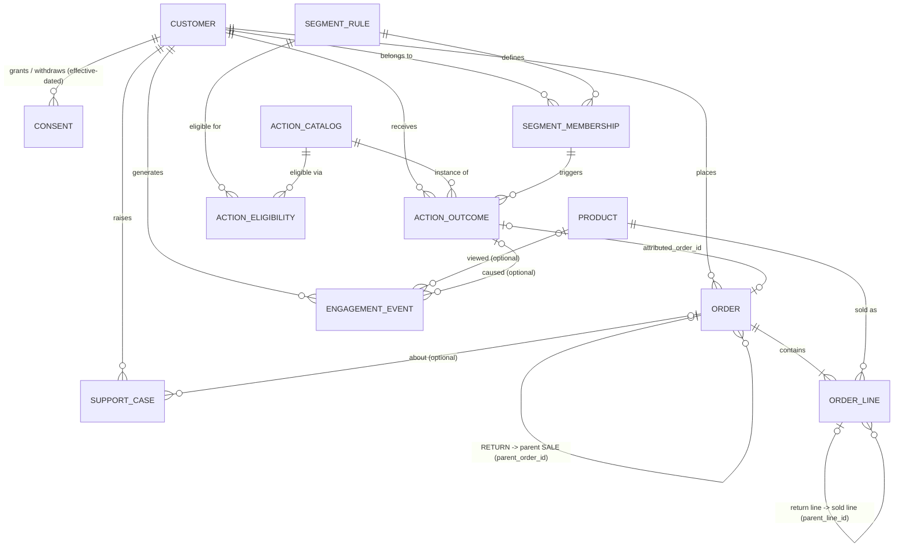

# Entity-relationship diagram

## Cardinality summary

| Relationship | Cardinality | Notes |
|---|---|---|
| Customer - Order | 1:N | prospects have 0 orders (optional side) |
| Order - OrderLine | 1:N (at least 1) | |
| Order - Product | **N:M** via `order_lines` (bridge) | |
| Customer - SegmentRule | **N:M** via `segment_memberships` (bridge, effective-dated) | at most one active exclusive-group membership per customer |
| SegmentRule - ActionCatalog | **N:M** via `action_eligibility` (bridge) | `priority` orders alternatives |
| Customer - Consent | 1:N | one *chain* of rows per (channel, purpose) |
| SALE Order - RETURN Order | 1:N optional | return events never overwrite the sale |
| ActionOutcome - EngagementEvent | 1:N optional | opens / clicks caused by a SEND |
| ActionOutcome - Order | 0..1:1 | `attributed_order_id` (ORDER_14D metric only) |

## Lifecycle states and effective dating

| Entity | State / effective dating | History preserved by |
|---|---|---|
| Customer | `lifecycle_state`: PROSPECT, NEW, ACTIVE, AT_RISK, DORMANT (derived at snapshot 2) | segment membership rows at two snapshots |
| Consent | GRANTED / WITHDRAWN, `effective_from` / `effective_to` | new row per change, previous row closed |
| SegmentMembership | `effective_from` / `effective_to`, `is_current` | row closed (not deleted) when the customer leaves a segment |
| SegmentRule / ActionCatalog / ActionEligibility | `version`, `status`, `effective_from` / `effective_to` | new version = new row |
| Order | SALE then RETURN event | return is its own order row with negative lines |
| SupportCase | OPEN -> CLOSED (`closed_at`) | timestamps on the row |
| ActionOutcome | recommended -> SUPPRESS / HOLDOUT / SEND -> delivered -> engaged / success | `recommended_at`, `sent_at`, `evaluated_at`, `outcome_status` |
